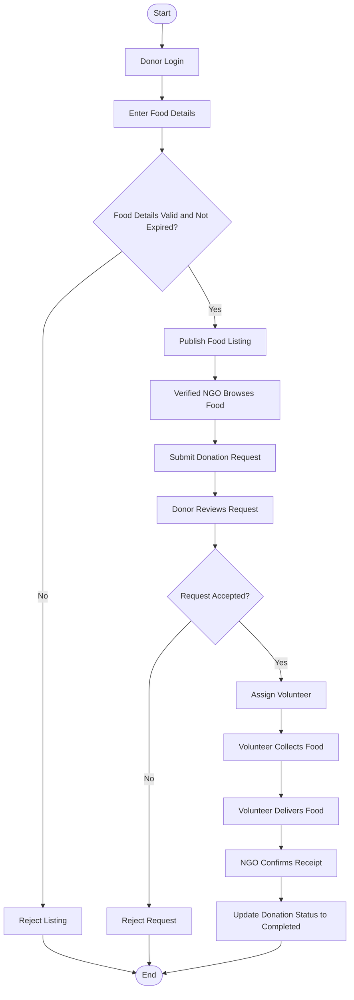

# FoodLoop – Activity Diagram

## 1. Purpose

The activity diagram represents the workflow of food donation and redistribution in FoodLoop.

## 2. Main Workflow

1. Donor logs into FoodLoop.
2. Donor enters surplus food details.
3. System validates the food information and expiry time.
4. If the information is invalid or the food is expired, the system rejects the listing.
5. If valid, the food listing is published.
6. Verified NGOs browse available food.
7. NGO selects a food donation and submits a request.
8. Donor reviews the request.
9. Donor accepts or rejects the request.
10. If rejected, the request is closed.
11. If accepted, a volunteer is assigned.
12. Volunteer collects the food.
13. Volunteer delivers the food to the NGO.
14. NGO confirms receipt.
15. System marks the donation as completed.

## 3. Activity Diagram

## 4. Conclusion

The activity diagram explains the complete donation workflow, including validation, NGO requests, donor approval, volunteer delivery and donation completion.