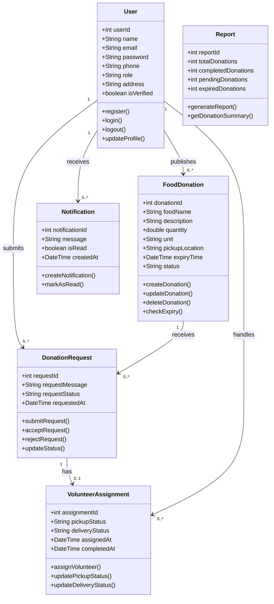

# FoodLoop – Class Diagram

## 1. Purpose

The class diagram represents the main classes, attributes, methods and relationships in the FoodLoop application.

## 2. Main Classes

### 1. User
Attributes:
- userId
- name
- email
- password
- phone
- role
- address
- isVerified

Methods:
- register()
- login()
- logout()
- updateProfile()

### 2. FoodDonation
Attributes:
- donationId
- foodName
- description
- quantity
- unit
- pickupLocation
- expiryTime
- status

Methods:
- createDonation()
- updateDonation()
- deleteDonation()
- checkExpiry()

### 3. DonationRequest
Attributes:
- requestId
- requestMessage
- requestStatus
- requestedAt

Methods:
- submitRequest()
- acceptRequest()
- rejectRequest()
- updateStatus()

### 4. VolunteerAssignment
Attributes:
- assignmentId
- pickupStatus
- deliveryStatus
- assignedAt
- completedAt

Methods:
- assignVolunteer()
- updatePickupStatus()
- updateDeliveryStatus()

### 5. Notification
Attributes:
- notificationId
- message
- isRead
- createdAt

Methods:
- createNotification()
- markAsRead()

### 6. Report
Attributes:
- reportId
- totalDonations
- completedDonations
- pendingDonations
- expiredDonations

Methods:
- generateReport()
- getDonationSummary()

## 3. Class Diagram

## 4. Conclusion

The class diagram describes the main objects required for FoodLoop. It provides a blueprint for implementing Java classes and database entities in the backend.