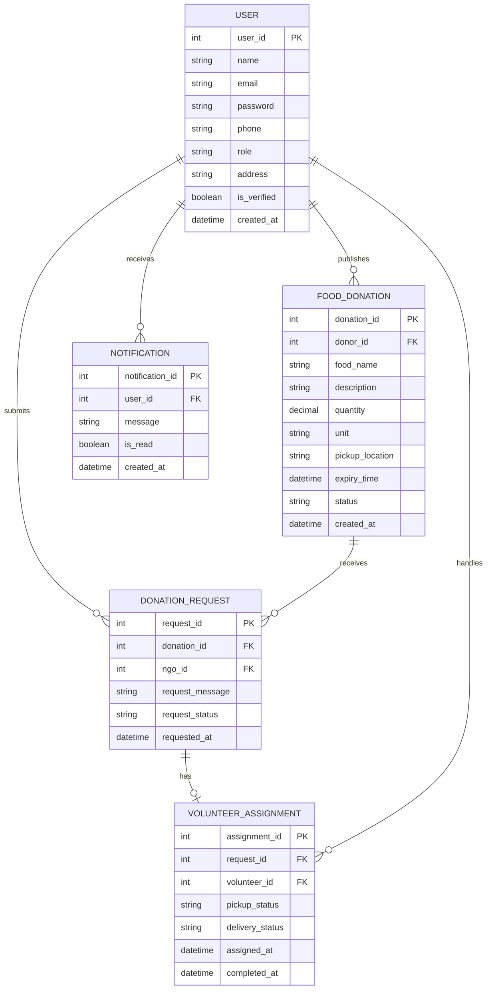

# FoodLoop – Entity Relationship Diagram

## 1. Database Entities

### 1. User
Stores information about all registered users.

Attributes:
- user_id (Primary Key)
- name
- email
- password
- phone
- role
- address
- is_verified
- created_at

### 2. FoodDonation
Stores surplus food information published by donors.

Attributes:
- donation_id (Primary Key)
- donor_id (Foreign Key)
- food_name
- description
- quantity
- unit
- pickup_location
- expiry_time
- status
- created_at

### 3. DonationRequest
Stores food donation requests submitted by NGOs.

Attributes:
- request_id (Primary Key)
- donation_id (Foreign Key)
- ngo_id (Foreign Key)
- request_message
- request_status
- requested_at

### 4. VolunteerAssignment
Stores volunteer pickup and delivery assignments.

Attributes:
- assignment_id (Primary Key)
- request_id (Foreign Key)
- volunteer_id (Foreign Key)
- pickup_status
- delivery_status
- assigned_at
- completed_at

### 5. Notification
Stores notifications sent to users.

Attributes:
- notification_id (Primary Key)
- user_id (Foreign Key)
- message
- is_read
- created_at

## 2. Relationships

1. One donor can publish many food donations.
2. One food donation can receive multiple NGO requests.
3. One NGO can submit many donation requests.
4. One donation request can have one volunteer assignment.
5. One volunteer can receive multiple assignments.
6. One user can receive multiple notifications.

## 3. ER Diagram

## 4. Conclusion

The ER diagram defines the main database entities and their relationships. It will serve as the foundation for creating the FoodLoop MySQL database.