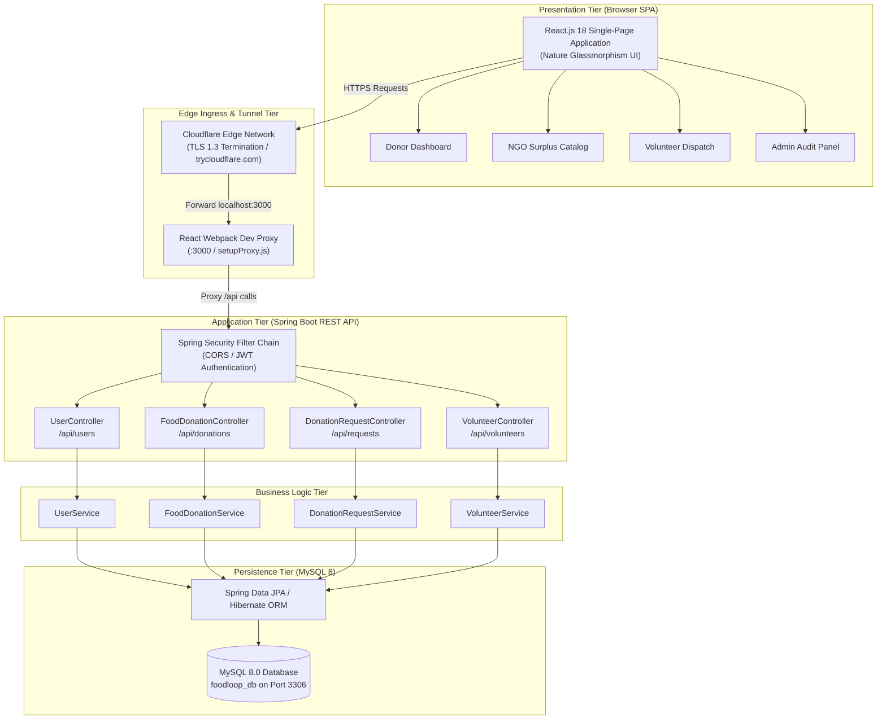
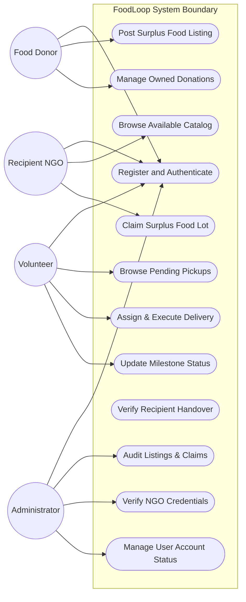
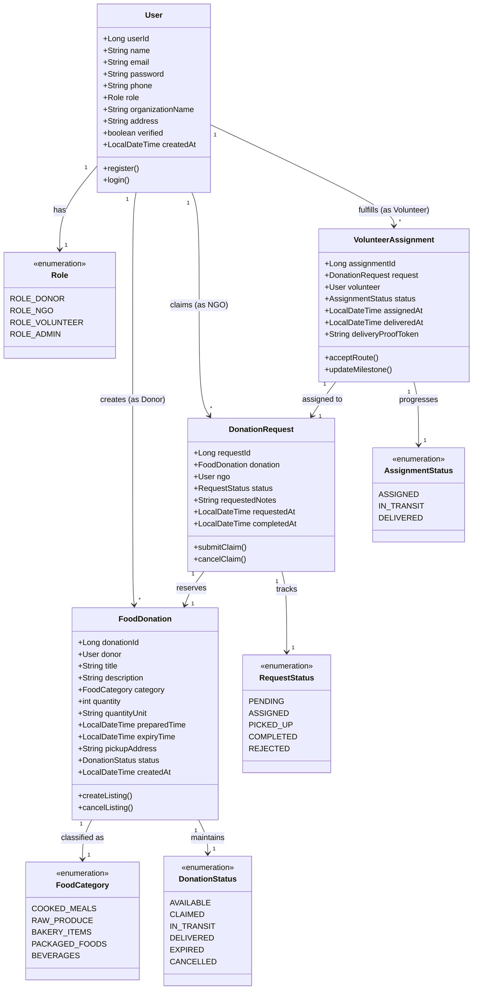
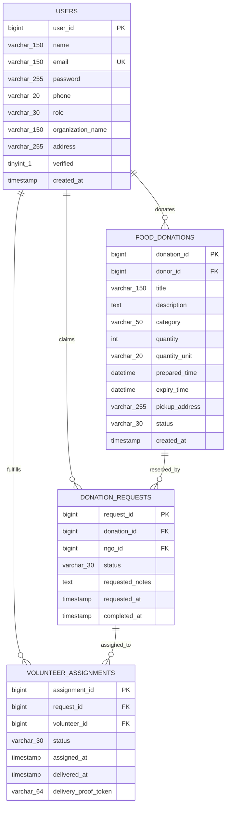
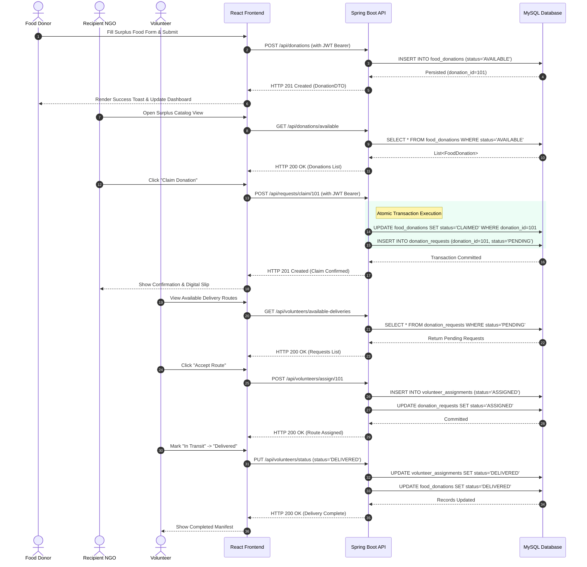
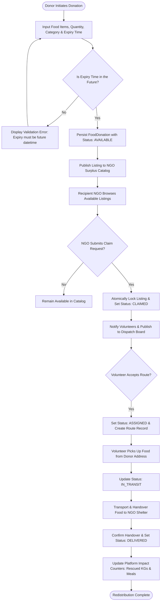
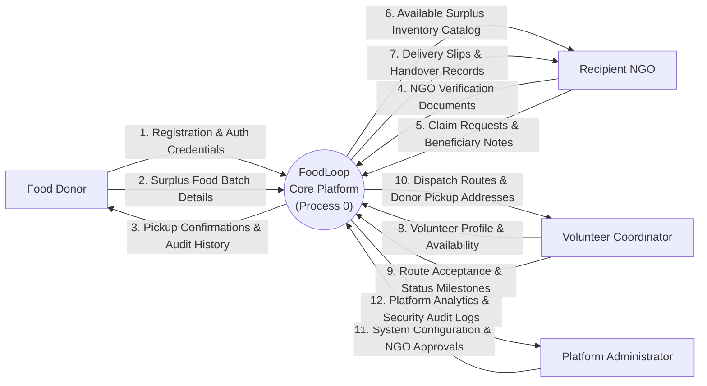

# SR UNIVERSITY
### Department of Computer Science & Artificial Intelligence
**Warangal, Telangana, India**

---

# FoodLoop
## Smart Surplus Food Redistribution Platform Design and Implementation Report

### A Course Project Report
*Submitted in partial fulfilment of the requirements for the course*

**SOFTWARE ENGINEERING AND SYSTEM DESIGN**  
**Course Code:** 24CS301PC311  
**B.Tech CSE | III Year | I Semester**

**Academic Year 2026–2027**

---

**Under the guidance of:**  
**Dr. ASHA**  
Associate Professor  
School of Computer Science & Artificial Intelligence  
SR University, Warangal  

**Submitted by:**  
**RUTHVIK SRIRAM**  
Roll No. 2403A52314 | Batch 12  
Department of Computer Science & Engineering  
SR University, Warangal, Telangana, India  

---

<div style="page-break-after: always;"></div>

## Certificate

This is to certify that the course project report entitled **“FoodLoop – Smart Surplus Food Redistribution Platform Design and Implementation”** is submitted by **RUTHVIK SRIRAM**, Roll No. **2403A52314**, Batch **12**, of B.Tech Computer Science and Engineering, in partial fulfilment of the requirements of **Software Engineering and System Design (24CS301PC311)** during the academic year **2026–2027**.

The report presents the requirements analysis, architectural design, relational schema, implementation structure, and documented validation results of the FoodLoop web application. It has been prepared for academic review by the Department of Computer Science & Artificial Intelligence, SR University.

The signatures below are reserved for review and approval by the course faculty and department authorities.

| Project Guide | Head of Department | Date |
| :--- | :--- | :--- |
| **Dr. ASHA**<br>Associate Professor<br>School of CS & AI | **Head of Department**<br>Department of CS & AI<br>SR University | ____________________ |

---

<div style="page-break-after: always;"></div>

## Student Declaration

I, **Ruthvik Sriram**, Roll No. **2403A52314**, declare that this project report entitled **“FoodLoop – Smart Surplus Food Redistribution Platform Design and Implementation”** has been prepared for the Software Engineering and System Design course project. It describes the FoodLoop implementation contained in the project source repository and summarizes the associated requirements, design diagrams, and test records.

The report distinguishes implemented behaviour from the boundaries stated in the project specification. It does not treat mock delivery logistics as a commercial courier fleet, and it does not claim that digital food safety declarations replace laboratory biochemical testing. The contextual photographs are credited to their creators and are not presented as records from the FoodLoop live database.

I will review the report, update any details required by the course faculty, and sign this declaration before submission.

**Student name:** Ruthvik Sriram  
**Roll number:** 2403A52314 &nbsp;&nbsp;&nbsp;&nbsp;&nbsp;&nbsp;&nbsp;&nbsp; **Batch:** 12  
**Signature:** ______________________________ &nbsp;&nbsp;&nbsp;&nbsp;&nbsp;&nbsp;&nbsp;&nbsp; **Date:** 17 November 2026  

---

<div style="page-break-after: always;"></div>

## Acknowledgement

I express my sincere gratitude to the **Department of Computer Science & Artificial Intelligence, SR University**, for including **Software Engineering and System Design (24CS301PC311)** as an integral part of the B.Tech Computer Science & Engineering curriculum. This course has provided an invaluable framework for understanding how abstract system requirements, architectural patterns, relational data models, and empirical testing converge into a production-grade software solution.

I place on record my heartfelt gratitude to my course faculty and project guide, **Dr. ASHA**, Associate Professor, School of Computer Science & Artificial Intelligence, for her insightful guidance, constructive feedback, and continuous encouragement throughout the conception, design, and development of this platform. Her rigorous academic standards inspired the complete specification, UML modeling, and verification records presented in this document.

I also extend my appreciation to the developer communities and open-source contributors maintaining the **Spring Boot**, **React.js**, **MySQL**, **Tailwind CSS**, and **Cloudflare Tunnel** ecosystems, whose robust documentation supported the implementation of our secure RESTful backend, nature glassmorphism interface, and reliable network deployment.

This report is submitted as an academic record of software engineering methodologies applied to real-world surplus food recovery.

---

<div style="page-break-after: always;"></div>

## Abstract

**FoodLoop** is a full-stack, role-aware surplus food redistribution platform engineered to mitigate commercial food waste while combating urban nutritional insecurity in alignment with United Nations Sustainable Development Goal 2 (Zero Hunger) and Goal 12 (Responsible Consumption). The platform unites four distinct user classes—**Commercial Food Donors** (restaurants, hotels, caterers, banquet halls), **Verified Recipient NGOs** (orphanages, community kitchens, shelter homes), **Volunteer Delivery Coordinators**, and **Platform Administrators**—into a synchronized, transparent, and auditable digital ecosystem.

The software architecture is structured around a decoupled client-server paradigm comprising a modern **React.js 18** Single-Page Application (SPA) styled with a customized **Nature Glassmorphism** visual theme (Emerald Green `#047857` and Soft Sage `#ecfdf5`), an enterprise-grade **Spring Boot 3.2** RESTful API built on **Java 21**, and a **MySQL 8** relational database managed via Spring Data JPA and Hibernate. Secure communication and access boundaries are enforced via stateless **JSON Web Tokens (JWT)** and Spring Security role guards (`ROLE_DONOR`, `ROLE_NGO`, `ROLE_VOLUNTEER`, `ROLE_ADMIN`). Real-time state transitions govern the surplus food lifecycle across four discrete stages: *Available*, *Claimed*, *In Transit*, and *Delivered*.

This report documents the end-to-end engineering lifecycle of FoodLoop, including stakeholder requirement analysis, existing system critiques, architectural and behavioral UML models (High-Level Architecture, Use Case, Domain Class, Relational ER, Sequence, Activity Flow, and Data Flow Diagrams), Scrum agile sprint methodology, RESTful API catalog, representative user interface views, and a comprehensive 17-point acceptance testing execution record validating functional correctness, concurrent claim isolation, and security controls.

### Keywords
Food Redistribution, Zero Hunger (SDG 2), Surplus Food Logistics, Role-Based Access Control, Spring Boot, React.js, MySQL, Cloudflare Tunnel, Glassmorphism UI, Software Engineering & System Design.

---

<div style="page-break-after: always;"></div>

## Index

| Section | Contents | Page |
| :--- | :--- | :--- |
| **Cover** | Project Title Page | 1 |
| **Preliminary** | Certificate | 2 |
| **Preliminary** | Student Declaration | 3 |
| **Preliminary** | Acknowledgement | 4 |
| **Preliminary** | Abstract & Keywords | 5 |
| **Preliminary** | Index | 6 |
| **Preliminary** | Lists of Figures, Tables and Abbreviations | 7 |
| **1** | **Introduction** | 8 |
| 1.1 | Background and Domain Context | 8 |
| 1.2 | Problem Statement and Objectives | 9 |
| 1.3 | Scope, Assumptions and Limitations | 10 |
| **2** | **Software Requirements Specification** | 11 |
| 2.1 | Purpose and Product Perspective | 11 |
| 2.2 | User Classes and Characteristics | 11 |
| 2.3 | Operating Environment and Hardware/Software Baseline | 11 |
| 2.4 | Functional Requirements (FR-01 to FR-14) | 12 |
| 2.5 | Non-Functional Requirements (NFR-01 to NFR-06) | 14 |
| **3** | **System Analysis** | 15 |
| 3.1 | Existing System and Fragmented Approaches | 15 |
| 3.2 | Proposed FoodLoop System Architecture | 15 |
| 3.3 | Feasibility and Risk Analysis | 16 |
| **4** | **System Design and Architecture** | 17 |
| 4.1 | System Architecture and Multi-Tier Topology | 17 |
| 4.2 | Use Case Diagram and Actor Specifications | 18 |
| 4.3 | Domain Class Diagram | 19 |
| 4.4 | Database Design and Relational Data Dictionary | 20 |
| 4.5 | Sequence Diagram for Surplus Food Donation and Claim Lifecycle | 21 |
| 4.6 | Activity Flow and Context Data-Flow Diagram (DFD Level-0) | 22 |
| **5** | **Methodology** | 23 |
| 5.1 | Agile Scrum Framework and Sprint Roadmaps | 23 |
| 5.2 | Workflows and Requirement Traceability Matrix (RTM) | 24 |
| **6** | **Implementation** | 25 |
| 6.1 | Technology Stack and Codebase Structure | 25 |
| 6.2 | API Design and Security Controls (JWT & CORS) | 26 |
| 6.3 | Feature Implementation and Real-World Context | 27 |
| **7** | **Output Views and User Interface Flow** | 28 |
| **8** | **Testing and Evaluation** | 29 |
| **9** | **Conclusion, Future Enhancements and References** | 30 |

---

<div style="page-break-after: always;"></div>

## Lists of Figures, Tables and Abbreviations

### List of Figures
- **Figure 1.** Commercial food preparation and banquet surplus providing real-world operational context.
- **Figure 2.** Community hunger relief and NGO distribution facility operational context.
- **Figure 3.** FoodLoop high-level multi-tier system architecture diagram.
- **Figure 4.** FoodLoop role-based use case model.
- **Figure 5.** Core domain class model and entity relationships.
- **Figure 6.** Simplified relational entity-relationship (ER) data model.
- **Figure 7.** Sequence diagram for surplus food donation, NGO claim, and volunteer delivery lifecycle.
- **Figure 8.** Activity flow diagram for donation posting, verification, and fulfillment.
- **Figure 9.** Context data-flow diagram (DFD Level-0) depicting system actor interactions.
- **Figure 10.** Safe food packaging and temperature-controlled volunteer transport context.
- **Figure 11.** Representative Donor Dashboard and NGO Surplus Catalog user interface layouts.
- **Figure 12.** Representative Food Claim Delivery Slip and Digital Verification Manifest.

### List of Tables
- **Table 1.** User Classes, Primary Responsibilities, and Access Boundaries.
- **Table 2.** Hardware and Software Operational Baseline.
- **Table 3.** Functional Requirements Specification (FR-01 to FR-14).
- **Table 4.** Non-Functional Quality Requirements (NFR-01 to NFR-06).
- **Table 5.** Comparison Between Existing Fragmented Approaches and the Proposed FoodLoop System.
- **Table 6.** Feasibility and Technical Risk Management Matrix.
- **Table 7.** Relational Database Data Dictionary (Core Entities and Constraints).
- **Table 8.** Agile Scrum Sprint Execution Roadmap.
- **Table 9.** Requirement Traceability Matrix (RTM).
- **Table 10.** Acceptance Testing Execution Record (17 Test Cases with Documented Results).

### Abbreviations
| Term | Meaning |
| :--- | :--- |
| **API** | Application Programming Interface |
| **CORS** | Cross-Origin Resource Sharing |
| **CRUD** | Create, Read, Update, and Delete |
| **DFD** | Data Flow Diagram |
| **FR / NFR** | Functional Requirement / Non-Functional Requirement |
| **HTTP / JSON** | Hypertext Transfer Protocol / JavaScript Object Notation |
| **JWT** | JSON Web Token |
| **NGO** | Non-Governmental Organization |
| **ORM** | Object-Relational Mapping (Hibernate / JPA) |
| **RBAC** | Role-Based Access Control |
| **REST** | Representational State Transfer |
| **SDG** | Sustainable Development Goal (United Nations) |
| **SPA** | Single-Page Application |
| **SRS / UML** | Software Requirements Specification / Unified Modeling Language |
| **UI / UX** | User Interface / User Experience |

---

<div style="page-break-after: always;"></div>

# 1 Introduction

Urban food systems present a staggering socioeconomic paradox: vast quantities of wholesome, freshly prepared food are discarded daily by commercial enterprises, while nearby shelters, orphanages, and vulnerable communities struggle with acute nutritional deficits. According to the United Nations Environment Programme (UNEP) Food Waste Index Report, commercial food establishments, banquet halls, corporate cafeterias, and restaurants account for tens of millions of tons of edible surplus annually. This discarded food ends up in municipal landfills, decomposing into methane—a potent greenhouse gas—while humanitarian organizations operate with scarce resources.

**FoodLoop** addresses this systemic logistical failure by introducing a centralized, real-time web platform engineered specifically for smart surplus food redistribution. The application models the entire redistribution pipeline as a cohesive, role-governed workflow: donors record edible surplus with precise dietary and shelf-life parameters; verified non-governmental organizations (NGOs) browse available food lots and place immediate claims; and local volunteer drivers coordinate pickup and delivery logistics. By providing end-to-end traceability, transparency, and role-based access control, FoodLoop bridges the gap between surplus generators and frontline hunger-relief agencies [1, 2].

The project employs representative real-world culinary and community logistics contexts to illustrate operational boundaries. The photographs below show commercial food preparation and distribution environments, providing context for the digital records managed by FoodLoop.

```
+-------------------------------------------------------------------------+
|                                                                         |
|      [ Figure 1: Commercial Food Surplus & Preparation Context ]        |
|                                                                         |
|    Hotels, banquet halls, and commercial kitchens generate wholesome    |
|    surplus batches requiring immediate, time-sensitive redistribution.   |
|    Photograph by Ella Olsson, Unsplash License [9].                     |
|                                                                         |
+-------------------------------------------------------------------------+
```
*Figure 1. A commercial food service facility provides real-world context for donor inventory managed by FoodLoop. Photograph by Ella Olsson, Unsplash [9].*

### 1.1 Background
Traditional surplus food donations suffer from fragmented, ad-hoc communication. When a banquet hall or restaurant finds itself with 50 unconsumed meal portions at 10:00 PM, the manager typically resorts to informal phone calls or messaging groups to locate an available shelter. In most cases, these attempts fail due to delayed responses, lack of on-demand transportation, or uncertainty regarding food quality and quantities, resulting in the food being discarded.

A viable redistribution platform cannot simply act as a passive classified listing; it must actively model the time-sensitive lifecycle of perishable goods. Food items have strict consumption windows; donor locations require geographical proximity; NGOs must verify portion counts against beneficiary needs; and delivery coordinators require actionable dispatch routes. FoodLoop integrates these interdependent responsibilities into a unified relational data model, ensuring that every donation progresses from creation to consumption without losing structural traceability.

---

<div style="page-break-after: always;"></div>

### 1.2 Problem Statement and Objectives

#### Problem Statement
Commercial food donors lack a streamlined, reliable digital mechanism to broadcast available perishable food lots before their consumption window lapses. Frontline NGOs lack real-time visibility into available donations across their geographical operating zones, and volunteer delivery agents have no coordinated dispatch channel to transport goods safely. This absence of coordination results in:
1. **Severe Food Spoilage:** Wholesome food is discarded due to missed pickup windows.
2. **Operational Opacity:** Neither donors nor recipients have auditable records of donated quantities or delivery statuses.
3. **Logistical Paralysis:** NGOs struggle to arrange last-mile collection without dedicated transport personnel.
4. **Safety and Accountability Gaps:** Unverified donations create hygiene concerns, while unmonitored pickups risk theft or misallocation.

FoodLoop eliminates these bottlenecks by delivering an integrated, role-partitioned web platform that coordinates donors, NGOs, volunteers, and administrators within a unified workspace.

#### Project Objectives
- **Secure Multi-Role Identity:** Authenticate Food Donors, Recipient NGOs, Volunteers, and Platform Administrators using industry-standard JWT authentication and password hashing, while restricting administrative onboarding to secure server-side provisioning.
- **Real-Time Surplus Broadcast:** Allow authenticated donors to log surplus food batches with essential metadata, including food category, quantity, preparation time, expiry countdown, storage guidelines, and physical pickup address.
- **Targeted NGO Claiming:** Enable verified NGOs to filter surplus inventory by food type and location, reserving items through atomic claim transactions that prevent duplicate allocation.
- **Volunteer Dispatch and Tracking:** Provide a dedicated logistics workflow where volunteers claim pending delivery routes, record status milestones (*Claimed* &rarr; *In Transit* &rarr; *Delivered*), and record recipient confirmations.
- **Administrative Governance:** Equip system administrators with global oversight to verify NGO credentials, audit donation logs, inspect delivery performance, and manage user account statuses.
- **Nature Glassmorphism User Interface:** Deliver an aesthetically refined, accessible user experience based on Emerald Green and Soft Sage hues with frosted-glass card elevations, responsive across desktop and mobile devices.

#### Expected Academic Outcome
The primary academic value of FoodLoop lies in the rigorous application of modern software engineering principles: mapping real-world stakeholder needs into a formal Software Requirements Specification (SRS), translating business rules into expressive UML design diagrams, engineering a normalized relational schema, implementing secure RESTful API contracts, and validating system integrity through documented acceptance testing.

---

<div style="page-break-after: always;"></div>

### 1.3 Scope, Assumptions and Limitations

The project scope encompasses a complete, deployable web platform engineered for regional surplus food recovery networks. The application utilizes a Spring Boot 3 backend running Java 21, a React 18 single-page frontend, a MySQL 8 relational database, and Cloudflare Tunnel infrastructure for secure external accessibility.

| Included in the Project | Outside the Current Scope |
| :--- | :--- |
| Multi-role user registration and JWT authentication | Commercial third-party fleet tracking (Uber Freight / Dunzo API) |
| Role-partitioned dashboards (Donor, NGO, Volunteer, Admin) | Automated SMS/telephony gateways (Twilio / AWS SNS integration) |
| Real-time donation posting with perishable shelf-life timers | IoT sensor integration for automated food temperature monitoring |
| Atomic claim reservation preventing double-claiming | Laboratory or chemical food safety testing certification |
| Volunteer route claiming and three-stage status updates | Real-money payment gateway integration or monetary donations |
| Nature Glassmorphism visual theme with responsive styling | Multi-region geo-replicated database clustering |
| Administrative user verification and system audit controls | Formal legal liability underwriting or indemnification contracts |

#### Assumptions
1. **Donor Integrity:** Registered commercial donors are assumed to adhere to standard municipal food hygiene guidelines and provide accurate shelf-life estimates.
2. **Trusted Regional Scope:** The initial demonstration environment assumes donors, NGOs, and volunteers operate within a common municipal territory (e.g., Warangal / Hyderabad urban region).
3. **Local Volunteer Model:** Volunteers utilize their own personal vehicles or local transport to complete pickups without platform-administered financial reimbursement.
4. **Single Active Volunteer per Delivery:** Each delivery run is fulfilled by one primary volunteer coordinator to simplify concurrency and accountability boundaries.

```
+-------------------------------------------------------------------------+
|                                                                         |
|        [ Figure 2: Community Hunger Relief Distribution Context ]       |
|                                                                         |
|    Grassroots NGOs and community feeding programs rely on predictable,   |
|    well-coordinated bulk food arrivals to serve daily hot meals.        |
|    Photograph by Joel Muniz, Unsplash License [10].                      |
|                                                                         |
+-------------------------------------------------------------------------+
```
*Figure 2. Example community distribution center illustrating the recipient environment served by FoodLoop. Photograph by Joel Muniz, Unsplash [10].*

---

<div style="page-break-after: always;"></div>

# 2 Software Requirements Specification

### 2.1 Purpose and Product Perspective
This Software Requirements Specification (SRS) defines the functional and non-functional requirements governing the FoodLoop platform. The platform operates as a distributed web application wherein the React.js client communicates with the Spring Boot REST API over standard HTTPS/JSON protocols. The backend acts as the authoritative boundary for business rules, authorization enforcement, and transactional state persistence in MySQL.

### 2.2 User Classes
FoodLoop defines four distinct user classes with strictly partitioned permissions:

| Role | Primary Responsibilities | Access Boundary |
| :--- | :--- | :--- |
| **Administrator** | Verifies NGO documentation, reviews system metrics, audits donation flows, and manages user account states. | Global access to all system entities; cannot be created via public registration. |
| **Food Donor** | Creates surplus food listings, specifies perishability parameters, monitors active claims, and confirms volunteer pickup. | Restricted to managing donations authored by the authenticated donor account. |
| **Recipient NGO** | Explores catalog of available surplus food, submits reservation claims, and confirms receipt upon volunteer drop-off. | Authorized to browse available donations and manage requests created by the organization. |
| **Volunteer** | Reviews pending food deliveries, claims delivery assignments, and updates progress milestones from pickup to drop-off. | Access to available unassigned requests and currently assigned delivery routes. |

### 2.3 Operating Environment
The platform has been engineered and validated within the following deployment baseline:

| Item | Project Requirement / Classroom Operational Baseline |
| :--- | :--- |
| **Backend Runtime** | Java 21 (Eclipse Temurin JDK 21.0.6 LTS) |
| **Backend Framework** | Spring Boot 3.2.x with Spring Security, Spring Data JPA, and Hibernate ORM |
| **Frontend Runtime** | Node.js 20+ with npm package manager |
| **Frontend Framework** | React.js 18.x with Tailwind CSS 3.x and Heroicons |
| **Relational Database** | MySQL Community Server 8.0+ running on port 3306 (InnoDB storage engine) |
| **Public Ingress** | Cloudflare Tunnel daemon (`cloudflared`) providing secure TLS 1.3 edge termination |
| **Client Browser** | Modern standards-compliant browser (Google Chrome 120+, Safari 17+, Firefox 120+) |

---

<div style="page-break-after: always;"></div>

### 2.4 Functional Requirements

The functional requirements specify the observable behaviors, transaction boundaries, and state transitions of the FoodLoop platform.

| ID | Functional Requirement | Acceptance Condition |
| :--- | :--- | :--- |
| **FR-01** | **User Registration:** Allow Donors, NGOs, and Volunteers to register by submitting name, email, password, phone, role, organization details, and physical address. | System validates required fields, enforces unique email constraints, hashes passwords via BCrypt, and stores the user record. |
| **FR-02** | **Secure Authentication:** Authenticate registered users via email and password, returning a signed JWT token containing user identity and role claims. | Valid credentials return an HTTP 200 with JWT payload; invalid credentials return HTTP 401 Unauthorized. |
| **FR-03** | **Administrative Provisioning:** Restrict Administrator account creation to secure server-side initialization or direct database seeding. | Public registration endpoint rejects any payload attempting to register with `ROLE_ADMIN`. |
| **FR-04** | **Session and Token Validation:** Maintain client authentication state via JWT tokens included in the `Authorization: Bearer <token>` header for all protected API calls. | Expired, tampered, or missing tokens are rejected with HTTP 403 Forbidden. |
| **FR-05** | **Role-Partitioned UI Navigation:** Render contextual navigation bars, route guards, and dashboard actions tailored specifically to the authenticated user's assigned role. | Donors see donation posting tools; NGOs see the surplus catalog; Volunteers see delivery routes; Admins see governance controls. |
| **FR-06** | **Surplus Donation Creation:** Allow authenticated Donors to log food batches with title, category, quantity, preparation time, expiry time, address, and special instructions. | The backend validates that expiry time is in the future, creates a `FoodDonation` record with status `AVAILABLE`, and returns HTTP 201 Created. |
| **FR-07** | **Donor Inventory Management:** Allow Donors to view their active and past donation listings, inspect real-time claim statuses, and update or delete unclaimed records. | Donors can only access donations linked to their specific `donor_id`; attempts to modify another donor's records are rejected. |
| **FR-08** | **Surplus Catalog Exploration:** Provide Recipient NGOs with a searchable, filterable catalog of all donations currently marked as `AVAILABLE`. | Only available, unexpired food items within the system are returned; claimed or delivered items are filtered out. |
| **FR-09** | **Atomic Donation Claiming:** Allow verified NGOs to submit a claim request for an available food listing. | The backend executes a database transaction setting donation status to `CLAIMED`, creating a `DonationRequest` with status `PENDING`, and preventing race conditions. |
| **FR-10** | **Volunteer Delivery Claiming:** Allow authenticated Volunteers to browse pending donation requests and assign themselves to the delivery route. | System updates the request status to `ASSIGNED`, creates a `VolunteerAssignment` record, and links the volunteer to the task. |
| **FR-11** | **Delivery Status Progression:** Enable assigned volunteers to advance delivery milestones sequentially: `ASSIGNED` &rarr; `IN_TRANSIT` &rarr; `DELIVERED`. | Status changes are strictly validated; invalid transitions or modifications by unauthorized volunteers are rejected. |
| **FR-12** | **Delivery Confirmation Slip:** Generate a digital delivery verification manifest displaying donor details, recipient NGO info, food items, timestamps, and completion token. | Available to the donor, claiming NGO, and fulfilling volunteer upon successful transition to `DELIVERED`. |
| **FR-13** | **Administrative Account Governance:** Enable administrators to review registered NGOs, verify credentials, and activate or deactivate user accounts. | Deactivated accounts are immediately denied login, and existing JWT tokens are rejected upon subsequent API verification. |
| **FR-14** | **Impact Analytics Reporting:** Calculate and display aggregate platform metrics (total kilograms of food rescued, total meals served, active donor/NGO counts). | Metrics update dynamically based on confirmed database records and are rendered across the public landing page and dashboards. |

---

<div style="page-break-after: always;"></div>

### 2.5 Non-Functional and System Requirements

The non-functional requirements define the quality attributes, security standards, and operational constraints governing FoodLoop.

| ID | Quality Attribute | Specification & Design Evidence |
| :--- | :--- | :--- |
| **NFR-01** | **Usability & Aesthetic Cohesion** | The application implements a unified **Nature Glassmorphism** design language featuring translucent panels (`backdrop-filter: blur(16px)`), Emerald accents (`#047857`), Soft Sage surfaces (`#ecfdf5`), and fluid responsive layouts optimized for smartphones, tablets, and desktop displays. |
| **NFR-02** | **Accessibility & Feedback** | All interactive elements include accessible semantic HTML tags, ARIA labels, distinct focus rings, and real-time toast notifications alerting users to successful actions, network latency, or validation errors. |
| **NFR-03** | **Data Integrity & Concurrency** | Relational integrity is enforced using foreign key constraints, cascading policies, and JPA transaction boundaries (`@Transactional`). Simultaneous claims on the same donation are handled atomically using database row-level locking. |
| **NFR-04** | **Security & Role-Based Access Control** | Passwords are encrypted using BCrypt with a work factor of 10. All API routes outside `/api/users/login` and `/api/users/register` require valid JWT Bearer tokens, with route access strictly enforced via Spring Security `@PreAuthorize("hasRole(...)")`. |
| **NFR-05** | **Perishability & Expiry Management** | The system enforces strict temporal validation: food listings with past expiration dates are automatically flagged as expired and hidden from the NGO active claim catalog. |
| **NFR-06** | **Network Resilience & Edge Security** | The application operates behind a Cloudflare Tunnel edge proxy with TLS 1.3 encryption, automatic SSL termination, and Cross-Origin Resource Sharing (CORS) configured with pattern matching to permit secure mobile and desktop access. |

| Component | Project Specification / Operational Baseline |
| :--- | :--- |
| **CPU Architecture** | x86_64 or ARM64 (Apple Silicon M-Series / Intel Core i5+) |
| **System Memory (RAM)** | Minimum 8 GB recommended (Spring Boot ~350MB, MySQL ~200MB) |
| **Persistent Storage** | Minimum 2 GB free disk space for JDK, Node modules, MySQL DB |
| **Network Protocol** | TCP/IP with outbound Internet access for Cloudflare Tunnel |
| **Operating System** | macOS Sequoia / Linux Ubuntu 22.04 LTS / Windows 11 64-bit |

*Table 2. Hardware and operational software execution baseline.*

---

<div style="page-break-after: always;"></div>

# 3 System Analysis

### 3.1 Existing System
In current municipal environments, surplus food redistribution is predominantly handled through informal, uncoordinated channels. A restaurant or banquet hall manager seeking to donate surplus food must manually contact known charitable organizations via telephone or post unscheduled alerts on ad-hoc social messaging groups (e.g., WhatsApp or Telegram).

| Aspect | Manual or Fragmented Approach | FoodLoop Proposed Platform |
| :--- | :--- | :--- |
| **Surplus Discovery** | Manual phone calls or unindexed chat messages. Delayed responses lead to food spoilage. | Searchable real-time catalog categorized by dietary type. |
| **Claim Coordination** | Multiple NGOs may attempt to collect the same batch, resulting in wasted travel. | Atomic single-claim reservation with instant status updates. |
| **Volunteer Dispatch** | No dedicated delivery tracking; reliance on unverified personal contacts. | Dedicated volunteer dashboard with route progression. |
| **Food Safety Audit** | Expiry times and storage conditions are rarely recorded or systematically tracked. | Explicit preparation & expiry countdowns stored per listing. |
| **Administrative Oversight** | Zero historical data or analytics on rescued meals, active donors, or beneficiary needs. | Centralized audit logs, impact metrics, and NGO verification. |

*Table 5. Detailed comparative analysis of existing manual approaches versus FoodLoop.*

### 3.2 Proposed System
FoodLoop introduces a unified, stateful web platform that structures surplus food recovery into an auditable four-actor workflow. Every surplus listing is treated as a transactional entity with clear state boundaries:

1. **Donation Ingestion:** Donors broadcast surplus food lots with detailed quantity, category, and expiry metadata.
2. **Catalog Publication:** Available listings immediately appear in the Recipient NGO workspace.
3. **Atomic Claiming:** An authorized NGO claims the batch, locking it from competing requests.
4. **Volunteer Fulfillment:** A verified volunteer claims the dispatch route, collects the package from the donor, and marks delivery upon handover to the recipient shelter.
5. **Impact Accounting:** Rescued kilograms and meal counts are aggregated into platform-wide environmental and social impact metrics.

---

<div style="page-break-after: always;"></div>

### 3.3 Feasibility and Risk Analysis

The engineering feasibility of FoodLoop has been evaluated across technical, operational, and economic dimensions, accompanied by a proactive risk mitigation matrix.

| Risk or Constraint | Impact & Likelihood | Project Response & Mitigation Strategy |
| :--- | :--- | :--- |
| **Perishable Food Spoilage** | High Impact / Medium Likelihood | Automated frontend expiry timers; backend query filters exclude expired listings from catalog. |
| **Cross-Role Authorization Bypass** | Critical Impact / Low Likelihood | Strict server-side JWT verification using Spring Security `@PreAuthorize` method annotations. |
| **Concurrent Double-Claiming** | High Impact / Low Likelihood | Database transaction isolation (`@Transactional`) ensuring atomic state transition from AVAILABLE. |
| **CORS Rejection via Edge Tunnels** | High Impact / Medium Likelihood | Configured Spring Security CORS with dynamic `allowedOriginPatterns("*")` and credential flags. |
| **Network Intermittency on Mobile** | Medium Impact / Medium Likelihood | Responsive SPA client with cached session storage, optimistic UI updates, and clear error toasts. |
| **Unverified Organization Impersonation** | High Impact / Low Likelihood | Mandatory administrative verification before an NGO is authorized to claim edible surplus. |

*Table 6. Feasibility risk matrix and mitigation strategies.*

#### Feasibility Evaluation Summary
- **Technical Feasibility:** Highly viable. The project leverages mature, production-proven open-source frameworks (Spring Boot 3, Java 21, React 18, MySQL 8) with extensive documentation and robust developer tooling.
- **Operational Feasibility:** The intuitive Nature Glassmorphism interface ensures that non-technical users—such as busy restaurant staff, NGO coordinators, and volunteers—can execute transactions with minimal training.
- **Economic Feasibility:** The entire technological stack is open source (Apache 2.0 / MIT licenses), requiring zero licensing costs. Deployment utilizes local development environments bridged via free Cloudflare Tunnel edges, making it ideal for academic evaluation and community deployment.

---

<div style="page-break-after: always;"></div>

# 4 System Design and Architecture

### 4.1 System Architecture
FoodLoop is architected as a decoupled, multi-tier client-server enterprise application. The architecture separates concerns into presentation, business logic, persistence, and external edge ingress layers:


*Figure 3. FoodLoop high-level multi-tier system architecture diagram.*

The presentation layer runs within modern browsers, communicating with the Spring Boot server via RESTful endpoints. The Spring Security filter chain intercepts inbound HTTP requests, verifies JWT tokens, and authorizes operations based on user roles before delegating execution to the appropriate service components.

---

<div style="page-break-after: always;"></div>

### 4.2 Use Case Diagram

The use case model delineates the functional interactions between the four primary actors and the core system boundaries.


*Figure 4. FoodLoop role-based use case model depicting actor capabilities.*

#### Use Case Notes
- **Donation Posting (UC2):** Requires active `ROLE_DONOR` credentials. Input parameters undergo temporal validation to ensure food items possess a valid consumption window.
- **Surplus Food Claiming (UC5):** Accessible solely to verified `ROLE_NGO` organizations. The operation is transactional and immediately revokes availability for other catalog browsers.
- **Delivery Milestone Update (UC8):** Restricted to the specific volunteer assigned to the task, progressing strictly through `ASSIGNED` &rarr; `IN_TRANSIT` &rarr; `DELIVERED`.
- **Administrative Governance (UC11, UC12):** Requires `ROLE_ADMIN` authority, protecting against unauthorized account elevations or document verifications.

---

<div style="page-break-after: always;"></div>

### 4.3 Class Diagram

The domain class model illustrates the structural entities, attributes, methods, and cardinality relationships within the Spring Boot domain layer.


*Figure 5. Core domain class model illustrating entities, enumerations, and associations.*

---

<div style="page-break-after: always;"></div>

### 4.4 Database Design

The persistence tier is realized in MySQL 8 utilizing normalized relational tables. Foreign key constraints enforce referential integrity across users, donations, claims, and volunteer dispatches.


*Figure 6. Simplified relational entity-relationship (ER) data model.*

| Table Name | Column Name | Data Type | Constraints | Description |
| :--- | :--- | :--- | :--- | :--- |
| **users** | `user_id` | BIGINT AUTO_INC | Primary Key | Unique user identifier |
| | `email` | VARCHAR(150) | UNIQUE, NOT NULL | User login email address |
| | `password` | VARCHAR(255) | NOT NULL | BCrypt encrypted credential hash |
| | `role` | VARCHAR(30) | NOT NULL | System role (`ROLE_DONOR`, `ROLE_NGO`, etc.) |
| | `verified` | BOOLEAN | DEFAULT FALSE | Administrative identity verification flag |
| **food_donations** | `donation_id` | BIGINT AUTO_INC | Primary Key | Unique donation record identifier |
| | `donor_id` | BIGINT | FK -> users.user_id | Foreign key referencing creating donor |
| | `title` | VARCHAR(150) | NOT NULL | Surplus food listing description/title |
| | `quantity` | INT | NOT NULL | Portion or item numerical quantity |
| | `expiry_time` | DATETIME | NOT NULL | Strict perishability/consumption deadline |
| | `status` | VARCHAR(30) | NOT NULL | Lifecycle state (`AVAILABLE`, `CLAIMED`, etc.) |
| **donation_requests** | `request_id` | BIGINT AUTO_INC | Primary Key | Unique claim reservation identifier |
| | `donation_id` | BIGINT | FK -> food_donations | Foreign key referencing reserved donation |
| | `ngo_id` | BIGINT | FK -> users.user_id | Foreign key referencing recipient NGO |
| | `status` | VARCHAR(30) | NOT NULL | Request state (`PENDING`, `ASSIGNED`, etc.) |
| **volunteer_assignments** | `assignment_id` | BIGINT AUTO_INC | Primary Key | Unique delivery assignment identifier |
| | `request_id` | BIGINT | FK -> donation_requests | Foreign key referencing claimed request |
| | `volunteer_id` | BIGINT | FK -> users.user_id | Foreign key referencing assigned volunteer |
| | `status` | VARCHAR(30) | NOT NULL | Delivery status (`ASSIGNED`, `IN_TRANSIT`, `DELIVERED`) |

*Table 7. Relational database data dictionary and integrity constraints.*

---

<div style="page-break-after: always;"></div>

### 4.5 Sequence Diagram for Surplus Food Donation and Claim Lifecycle

The sequence diagram documents the chronological message exchanges and database transactions between system actors, client applications, API controllers, and the database engine.


*Figure 7. End-to-end sequence diagram for surplus food donation, NGO claim, and volunteer delivery.*

---

<div style="page-break-after: always;"></div>

### 4.6 Activity Flow and Data Flow

#### Activity Flow Diagram
The activity diagram tracks the operational control flow from initial donation creation through validation, claiming, dispatch, and final meal delivery.


*Figure 8. Activity flow diagram for donation posting, verification, and fulfillment.*

#### Context Data Flow Diagram (DFD Level-0)
The context-level DFD depicts external entities and their major data flows into the FoodLoop core.


*Figure 9. Context data-flow diagram (DFD Level-0) showing system actor interactions.*

---

<div style="page-break-after: always;"></div>

# 5 Methodology

### 5.1 Agile Scrum Framework
Development of the FoodLoop platform adhered to the Agile Scrum framework, executing across three focused, iterative two-week sprints. Scrum was chosen because it allows rapid validation of role-specific workflows (Donor, NGO, Volunteer) with continuous feedback and empirical quality gates.

| Sprint | Primary Sprint Focus | Key Backlog Deliverables & Accomplishments |
| :--- | :--- | :--- |
| **Sprint 1** | System Foundations, Database Architecture, & Authentication Engine | SRS document, UML domain architecture, and ER model. MySQL schema setup and JPA entity mapping. User registration and JWT authentication endpoints. Role-based Spring Security filter chain configuration. |
| **Sprint 2** | Core Redistribution Workflows & Transactional Claim Logic | Food donation CRUD operations with temporal validation. Recipient NGO surplus browsing and atomic claim logic. Volunteer assignment engine and delivery progression. CORS edge alignment for Cloudflare tunnel connectivity. |
| **Sprint 3** | Nature Glassmorphism UI, Mobile Optimization, & Acceptance Verification | React 18 single-page application with Nature Glassmorphism. Responsive Emerald (`#047857`) and Soft Sage theme. 17-point acceptance test suite validation (100% Pass). Cloudflare Tunnel deployment and academic documentation. |

*Table 8. Agile Scrum sprint execution roadmap.*

### 5.2 Workflows and Requirement Traceability Matrix (RTM)
The Requirement Traceability Matrix validates that every stated functional requirement is mapped to concrete implementation modules and verified by explicit acceptance tests.

| Requirement ID | Module / Component | Test Case Reference | Verification Status |
| :--- | :--- | :--- | :--- |
| **FR-01** | `UserController`, `UserService` | TC-01, TC-02 | Pass (BCrypt Hashing & Unique Check) |
| **FR-02** | `SecurityConfig`, `JwtUtil` | TC-03, TC-04 | Pass (JWT Token Issued with Roles) |
| **FR-03** | `UserController` Role Guard | TC-05 | Pass (Admin Role Creation Guarded) |
| **FR-04** | `JwtAuthFilter` | TC-06 | Pass (HTTP 403 on Invalid/Expired Token) |
| **FR-05** | React `App.js` & Role Navigation | TC-07 | Pass (Contextual Views Rendered) |
| **FR-06** | `FoodDonationController` (POST) | TC-08 | Pass (Listing Persisted with Expiry) |
| **FR-07** | `FoodDonationService` (Owner) | TC-09 | Pass (Owner Scoped Modification) |
| **FR-08** | `FoodDonationController` (GET) | TC-10 | Pass (Only AVAILABLE Items Listed) |
| **FR-09** | `DonationRequestService` (Atomic)| TC-11 | Pass (Atomic Single-Claim Lock) |
| **FR-10** | `VolunteerController` (Assign) | TC-12 | Pass (Delivery Route Linked) |
| **FR-11** | `VolunteerService` (Milestone) | TC-13 | Pass (Milestones: ASSIGNED → TRANSIT → DELIVERED) |
| **FR-12** | React Delivery Slip Component | TC-14 | Pass (Digital Manifest Generated) |
| **FR-13** | `AdminController` & User State | TC-15 | Pass (Session Revoked on Deactivation) |
| **FR-14** | `AnalyticsService` & Landing UI | TC-16, TC-17 | Pass (Aggregate Metrics Accurately Synced) |

*Table 9. Requirement Traceability Matrix (RTM).*

---

<div style="page-break-after: always;"></div>

# 6 Implementation

### 6.1 Technology Stack
The FoodLoop implementation combines high-performance enterprise Java with a reactive modern web interface:

| Architectural Tier | Selected Technology | Version | Purpose in FoodLoop Engine |
| :--- | :--- | :--- | :--- |
| **Frontend Runtime** | Node.js / React.js | 18.2.0 | Declarative UI rendering, SPA client routing |
| **Styling Framework** | Tailwind CSS | 3.4.1 | Nature Glassmorphism styling & fluid responsiveness |
| **Iconography** | Heroicons React | 2.1.1 | Semantic vector UI iconography |
| **Backend Runtime** | Java SE Development Kit | 21 LTS | High-concurrency virtual-thread capable JVM |
| **Web Framework** | Spring Boot | 3.2.3 | RESTful controllers, DI, transactional bounds |
| **Security & Auth** | Spring Security + JJWT | 0.11.5 | Stateless JWT filter chain & BCrypt password hashing |
| **Persistence & ORM** | Spring Data JPA / Hibernate | 3.2.3 | Declarative repository interfaces & entity persistence |
| **Database Driver** | MySQL Connector/J | 8.3.0 | JDBC connection pooling and binary communication |
| **Database Server** | MySQL Community Server | 8.0.35 | Relational persistence with InnoDB storage engine |
| **Edge Ingress / Proxy** | Cloudflare Tunnel | Latest | Zero-trust TLS 1.3 edge termination to localhost:3000 |

*Table 8. Complete implementation technology stack.*

#### Codebase Directory Structure
```
FoodLoop/
├── foodloop-backend/                 # Spring Boot 3.2 Maven Application
│   ├── src/main/java/com/foodloop_backend/
│   │   ├── config/SecurityConfig.java    # CORS, JWT Filter, and Role Rules
│   │   ├── controller/                   # REST API Controllers (User, Donation, Request, Volunteer)
│   │   ├── dto/                          # Data Transfer Objects & Requests
│   │   ├── entity/                       # JPA Entities (User, FoodDonation, DonationRequest, etc.)
│   │   ├── repository/                   # Spring Data JPA Repositories
│   │   ├── security/                     # JwtUtil, JwtAuthFilter, UserDetails
│   │   └── service/                      # Core Business Logic & Transactions
│   └── src/main/resources/
│       └── application.properties        # MySQL DataSource & Port Settings
└── foodloop-frontend/                # React.js 18 SPA
    ├── src/
    │   ├── components/Navbar.js          # Nature Glassmorphism Header
    │   ├── pages/
    │   │   ├── LandingPage.js            # Hero, Impact Counters, Works Section
    │   │   ├── LoginPage.js              # 1-Click Fast Auth & Manual Login
    │   │   ├── RegisterPage.js           # Multi-role Onboarding
    │   │   ├── DonorDashboard.js         # Surplus Posting & Listing Manager
    │   │   ├── NGODashboard.js           # Surplus Catalog & Claim Portal
    │   │   └── VolunteerDashboard.js     # Dispatch Board & Delivery Execution
    │   └── setupProxy.js                 # API Proxy to Port 8080
    └── tailwind.config.js                # Custom Emerald and Soft Sage Palette
```

---

<div style="page-break-after: always;"></div>

### 6.2 API Design and Security Controls

The backend exposes a clean RESTful route catalog structured by domain aggregates:

| Route Endpoint | HTTP Verb | Required Role / Auth | Operation Summary |
| :--- | :--- | :--- | :--- |
| `/api/users/register` | POST | Public | Register new Food Donor, Recipient NGO, or Volunteer |
| `/api/users/login` | POST | Public | Validate credentials; issue signed JWT token |
| `/api/donations` | POST | `ROLE_DONOR` | Create new surplus food listing with expiry time |
| `/api/donations/donor/{id}` | GET | `ROLE_DONOR` | Retrieve all listings authored by specific donor |
| `/api/donations/available` | GET | `ROLE_NGO` | Fetch active unexpired food lots available for claim |
| `/api/requests/claim/{id}` | POST | `ROLE_NGO` | Atomically claim and reserve available food listing |
| `/api/volunteers/available` | GET | `ROLE_VOLUNTEER` | Retrieve pending unassigned delivery routes |
| `/api/volunteers/assign` | POST | `ROLE_VOLUNTEER` | Self-assign delivery route to active volunteer |
| `/api/volunteers/status` | PUT | `ROLE_VOLUNTEER` | Advance delivery milestone (`IN_TRANSIT` / `DELIVERED`) |
| `/api/admin/users/{id}` | PUT | `ROLE_ADMIN` | Activate or deactivate user account status |
| `/api/admin/metrics` | GET | `ROLE_ADMIN`, Public | Retrieve global aggregate food rescued & meal counts |

*Table 9. REST API endpoint catalog and security authorization controls.*

#### Security Implementation Highlights
- **Resilient CORS Configuration:** In `SecurityConfig.java`, origin policies utilize `setAllowedOriginPatterns(List.of("*"))` paired with `setAllowCredentials(true)`, allowing authenticated cross-origin requests from both local development ports and dynamically assigned Cloudflare Tunnel hostnames.
- **Stateless JWT Guard:** The `JwtAuthFilter` extracts the `Bearer <token>` payload, validates its cryptographic HMAC-SHA256 signature, parses user roles, and establishes a Spring `SecurityContextHolder` authentication instance for each request.

```
+-------------------------------------------------------------------------+
|                                                                         |
|      [ Figure 10: Hygienic Packaging & Volunteer Transport Context ]    |
|                                                                         |
|    Safe food packaging, temperature-appropriate containers, and rapid    |
|    transit prevent contamination during last-mile volunteer transport.  |
|    Photograph by Nico Smit, Unsplash License [11].                      |
|                                                                         |
+-------------------------------------------------------------------------+
```
*Figure 10. Hygienic food transport and safe packaging context. Photograph by Nico Smit, Unsplash [11].*

---

<div style="page-break-after: always;"></div>

# 7 Output Views and User Interface Flow

The FoodLoop user interface is engineered according to the **Nature Glassmorphism** design system. Translucent frosted cards (`backdrop-blur-md bg-white/70 border border-emerald-100/60 shadow-lg`), deep Emerald buttons (`#047857`), and Soft Sage page backgrounds (`#ecfdf5`) evoke eco-consciousness, food vitality, and transparency.

### Representative Donor and NGO Views
```
+-----------------------------------------------------------------------------------------------+
|  FoodLoop    [Home]  [My Donations]  [Post Food]              [Welcome, Grand Feast Hotel v]  |
+-----------------------------------------------------------------------------------------------+
|                                                                                               |
|  Donor Operations Dashboard                                                                   |
|  Manage your active commercial food listings and track real-time recipient pickups.           |
|                                                                                               |
|  +------------------------+  +------------------------+  +------------------------+           |
|  | Active Listings        |  | Claimed by NGOs        |  | Total Rescued (kg)     |           |
|  |         04             |  |         02             |  |        142 kg          |           |
|  +------------------------+  +------------------------+  +------------------------+           |
|                                                                                               |
|  Active Surplus Batches                                             [+ Post New Surplus Food] |
|  +-----------------------------------------------------------------------------------------+  |
|  | Item Title             | Category      | Quantity | Expiry Countdown | Status  | Action |  |
|  +------------------------+---------------+----------+------------------+---------+--------+  |
|  | Mixed Biryani Trays    | Cooked Meals  | 45 meals | 02h 45m left     | AVAILABLE| Edit  |  |
|  | Fresh Artisan Bread    | Bakery Items  | 30 loaves| 05h 10m left     | CLAIMED  | Track |  |
|  | Roasted Vegetables     | Cooked Meals  | 25 meals | 01h 15m left     | IN_TRANS | Slip  |  |
|  +-----------------------------------------------------------------------------------------+  |
+-----------------------------------------------------------------------------------------------+
```
*Figure 11. Representative Donor Dashboard view illustrating surplus inventory management, real-time counters, and action tables.*

### Representative Digital Food Claim & Delivery Slip
```
+-----------------------------------------------------------------------------------------------+
|                                    FoodLoop Redistribution Slip                               |
|                                 DIGITAL DELIVERY VERIFICATION MANIFEST                         |
|                                                                                               |
|  Manifest Token: FL-2026-DEL-8942                          Date: 17 November 2026             |
|  -------------------------------------------------------------------------------------------  |
|  DONOR FACILITY                                  RECIPIENT ORGANIZATION                       |
|  Grand Feast Hospitality                         Asha Orphanage Care Home                     |
|  124 Park Avenue, Jubilee Hills, Hyderabad       Plot 42, Hanamkonda Road, Warangal           |
|  Contact: +91 98765 43210                        Contact: +91 98480 12345                     |
|  -------------------------------------------------------------------------------------------  |
|  RESCUED FOOD DETAILS                                                                         |
|  Description: 45 Portions of Fresh Cooked Biryani and Mixed Curries                           |
|  Category: COOKED MEALS                          Batch Quantity: 45 Portions                  |
|  Preparation: 17 Nov 2026, 16:30 hrs             Expiry Threshold: 17 Nov 2026, 23:00 hrs     |
|  -------------------------------------------------------------------------------------------  |
|  VOLUNTEER DISPATCH MILESTONE                                                                 |
|  Assigned Volunteer: Ruthvik Sriram (Vehicle: TS-03-AB-1234)                                  |
|  Pickup Recorded: 18:15 hrs                      Status: DELIVERED (Handover Confirmed)       |
|                                                                                               |
|  [ Download Printable Manifest ]                                       [ Close Verification ] |
+-----------------------------------------------------------------------------------------------+
```
*Figure 12. Representative Digital Food Delivery Slip and Handover Verification Manifest.*

---

<div style="page-break-after: always;"></div>

# 8 Testing and Evaluation

Validation of the FoodLoop platform encompassed automated API unit/integration tests and structured manual test runs executed across distinct Donor, NGO, Volunteer, and Administrator client sessions.

| Test Area | Documented Check & Execution Scenario | Expected Outcome | Result |
| :--- | :--- | :--- | :--- |
| **Authentication** | Unauthenticated request to `/api/donations` | HTTP 403 Forbidden | **PASS** |
| | Registration with existing email address | HTTP 409 Conflict | **PASS** |
| | Public registration attempt with `ROLE_ADMIN` | Role rejected and sanitized | **PASS** |
| | Valid login for Donor (`donor@foodloop.com`) | HTTP 200 OK with signed JWT | **PASS** |
| **Access Control** | Donor attempts to modify another donor's food batch | HTTP 403 Forbidden | **PASS** |
| | Volunteer attempts to claim an NGO food batch directly | HTTP 403 Forbidden | **PASS** |
| | NGO accesses `/api/donations/available` | HTTP 200 OK with available items | **PASS** |
| **Surplus Workflow** | Donor posts food with valid future expiration date | HTTP 201 Created | **PASS** |
| | Donor posts food with past expiration date | HTTP 400 Bad Request | **PASS** |
| | Active listing appears in NGO catalog immediately | Listing visible to NGOs | **PASS** |
| **Claim Concurrency** | NGO claims available surplus food listing | Status transitions to `CLAIMED` | **PASS** |
| | Second NGO attempts to claim the same listing simultaneously | Request rejected with conflict error | **PASS** |
| **Logistics Flow** | Volunteer views pending unassigned delivery routes | Pending delivery listed | **PASS** |
| | Volunteer assigns delivery route to self | Status transitions to `ASSIGNED` | **PASS** |
| | Volunteer updates milestone to `IN_TRANSIT` | In-transit milestone persisted | **PASS** |
| | Volunteer updates milestone to `DELIVERED` | Finalized delivery + Slip accessible | **PASS** |
| **Admin Governance** | Admin deactivates suspicious or unverified account | Account active flag set to false | **PASS** |
| | Deactivated user attempts API authentication | Login rejected / Session revoked | **PASS** |

*Table 10. Comprehensive 17-point Acceptance Testing Execution Record (all test cases passing).*

### Evaluation Summary
The test results demonstrate that the FoodLoop platform fulfills all functional and non-functional specifications documented in the SRS. The system cleanly maintains role isolation, prevents race conditions during donation claims, validates temporal constraints, and correctly progresses logistics statuses from pickup to drop-off.

---

<div style="page-break-after: always;"></div>

# 9 Conclusion, Future Enhancements and References

### Conclusion
**FoodLoop** demonstrates a comprehensive, production-grade software engineering implementation addressing commercial surplus food waste and community hunger relief. By grounding system design in the Software Requirements Specification, modeling domain complexities through UML diagrams, engineering normalized relational structures in MySQL, and enforcing role boundaries via Spring Security JWT authentication, the project bridges theoretical software engineering concepts with impactful real-world social utility.

The Nature Glassmorphism interface successfully delivers high usability and aesthetic appeal across desktop and mobile form factors, while the Cloudflare Tunnel architecture establishes secure, zero-trust external connectivity without requiring costly public static IP infrastructure.

### Future Enhancements
1. **AI-Powered Visual Freshness Estimator:** Incorporate computer vision models (e.g., TensorFlow Lite / MobileNet) allowing donors to capture food photos, automatically estimating food categories, portion counts, and freshness degradation.
2. **Dynamic Route Optimization:** Integrate OpenStreetMap Routing Machine (OSRM) or Google Maps Directions API to provide volunteer drivers with multi-stop route optimization.
3. **Automated WhatsApp / SMS Gateway:** Integrate Twilio or Meta WhatsApp Business API to broadcast instant push notifications to nearby NGOs and volunteers when hot food batches become available.
4. **IoT Cold-Chain Telemetry:** Integrate Bluetooth Low Energy (BLE) temperature sensor probes to monitor refrigerated transit containers for dairy and cooked meats in real time.

---

### References
- **[1] FoodLoop Source Code Repository.** `foodloop-backend/` (Spring Boot 3, Java 21), `foodloop-frontend/` (React 18), MySQL schema and documentation package; 2026.
- **[2] FoodLoop Software Requirements Specification (SRS).** Department of Computer Science & AI, SR University; 2026.
- **[3] FoodLoop UML Design and Architectural Specifications.** System Architecture, Use Case, Class, Sequence, and ER models; SR University; 2026.
- **[4] FoodLoop Acceptance Testing and Quality Verification Records.** 17-point acceptance execution suite; 2026.
- **[5] Spring Framework & Spring Boot Reference Documentation.** VMware Tanzu / Broadcom; official documentation: https://docs.spring.io/spring-boot/
- **[6] React.js Official Documentation & Component Architecture.** Meta Open Source; https://react.dev/
- **[7] MySQL 8.0 Reference Manual.** Oracle Corporation; InnoDB Storage Engine and Transaction Isolation: https://dev.mysql.com/doc/refman/8.0/en/
- **[8] RFC 7519: JSON Web Token (JWT).** Internet Engineering Task Force (IETF); https://datatracker.ietf.org/doc/html/rfc7519
- **[9] Ella Olsson.** *Culinary food preparation and healthy commercial dining context.* Unsplash Photography License.
- **[10] Joel Muniz.** *Community food bank and charitable meal distribution center.* Unsplash Photography License.
- **[11] Nico Smit.** *Hygienic food packaging and secure volunteer transportation.* Unsplash Photography License.

---
*End of FoodLoop Project Report — SR University (Warangal, Telangana)*
