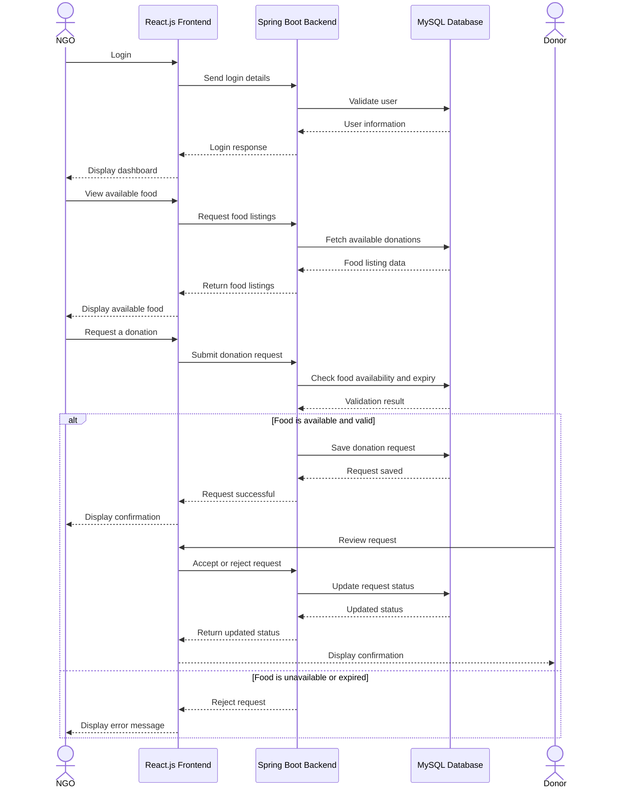

# FoodLoop – Sequence Diagram

## 1. Purpose

The sequence diagram explains how the Donor, NGO, React.js frontend, Spring Boot backend and MySQL database communicate when an NGO requests a food donation.

## 2. Sequence of Operations

1. NGO logs into the FoodLoop application.
2. React.js sends the login request to Spring Boot.
3. Spring Boot validates the login details.
4. NGO opens the available food listings.
5. Backend retrieves available food information from MySQL.
6. Frontend displays available donations.
7. NGO selects a food listing and submits a request.
8. Backend checks whether the food listing is available and not expired.
9. Backend stores the donation request in MySQL.
10. Backend sends a successful response to the frontend.
11. Donor views the incoming request.
12. Donor accepts or rejects the request.
13. Backend updates the request status in MySQL.
14. Frontend displays the updated status.

## 3. Sequence Diagram

## 4. Conclusion

The sequence diagram explains the order of communication between the NGO, frontend, backend, donor and database. It helps understand how FoodLoop processes donation requests.